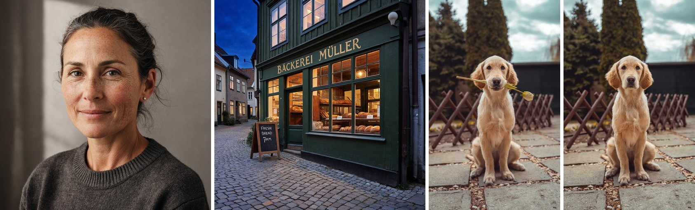

# Fibo 2.0

This directory contains the MFLUX MLX port of **Fibo 2.0** from [Bria](https://bria.ai) (CC BY-NC 4.0):
[`briaai/Fibo-2.0-dev`](https://huggingface.co/briaai/Fibo-2.0-dev) generates and edits images, and
[`briaai/Fibo-2.0-edit-turbo`](https://huggingface.co/briaai/Fibo-2.0-edit-turbo) is distilled from it for editing
in 4 steps without guidance.

Fibo 2.0 has an 8.1B transformer, the Qwen3-VL-4B text encoder and the FLUX.2 VAE. The transformer stacks 44
single-stream blocks like the Z-Image ones. The prompt reaches it in two ways: a 2-layer Perceiver compresses three
hidden layers of Qwen3-VL into 256 to 512 tokens that run in the stream with the image tokens, and 5 of the blocks
cross-attend to other groups of three layers. To edit, Qwen3-VL reads the images with the instruction, and their VAE
latents join the stream of the image being generated.

The model was trained on long structured JSON captions (Bria's VGL format), and it reads plain text too. Each text
that a caption asks the image to show (`text_render`) is also drawn as a small image, which Qwen3-VL reads.



*Dev, 1024x1024, 50 steps: a portrait and a street with a painted sign and a chalkboard, from structured captions.
Edit Turbo, 4 steps: a photo, then "Remove the tulip from the dog's mouth."*

## Text to image

```sh
mflux-generate-fibo2 \
  --prompt-file caption.json \
  --width 1024 \
  --height 1024 \
  --seed 42 \
  -q 8
```

The defaults follow the Dev model card: 50 steps, guidance 5 and the card's negative prompt for text to image, a
caption of soft, featureless images with blur, haze and lens flare. Each step runs the transformer two times.
`--negative-prompt` replaces the negative caption. Edits use the empty caption the model was trained with.

- Width and height must be multiples of 16. The model was trained at about one megapixel, for example 1024x1024,
  1424x800 or 1248x832.
- `--prompt` takes the JSON caption or plain text. `--prompt-file` reads it from a file.
- `--expand-prompt` writes a JSON caption from plain text with [FIBO-vlm](https://huggingface.co/briaai/FIBO-vlm)
  (about 9 GB on first use) and frees it before Fibo 2.0 runs. A JSON prompt is used as it is.
- `--scheduler` is ignored. The model samples on the schedule it was trained with.
- `--step-cache-ratio 0.25` skips the transformer on about a quarter of the steps. With 8-bit weights at 1024x1024
  the run took 205 s instead of 265 s, and the image kept its composition with small changes in detail. At 0.5
  it took 140 s, and the changes are easy to see.
- With `--steps 28`, our test images kept the subject and the layout of the 50-step images, with a little less
  detail, in 56% of the denoising time.

## Editing

`mflux-generate-fibo2-edit` edits one to five images. It runs Edit Turbo by default; `--model fibo-2.0-dev` runs Dev
(50 steps with guidance 5).

```sh
mflux-generate-fibo2-edit \
  --image-paths photo.jpg \
  --prompt "Change the jacket to a red leather one." \
  --seed 42
```

- The prompt is the instruction, or a JSON caption of the result with an `edit_instruction` key. A caption with
  `text_render` adds a text to the image.
- With several images, the instruction refers to them as `<image_1>`, `<image_2>` and so on.
- `--mask-image mask.png` changes only the white region of a single image. The mask must have the size of the image.
- Without `--width` and `--height`, the result has the size Fibo 2.0 was trained at for the aspect ratio of the first
  image, about one megapixel. A single image is cropped to the size of the result.
- Edit Turbo runs 4 steps without guidance. A `--guidance` other than 1 stops the command with an error.

## Structured captions

A caption is a JSON object with these fields, the format of Fibo 2.0's training captions (ThalesVGL in bria-vgl
0.10.0). The training captions always have the fields in bold:

| Field | Value |
| --- | --- |
| **`short_description`**, **`background_setting`**, **`context`**, `style_medium`, `artistic_style` | text |
| `objects` | a list of objects: **`description`**, **`location`**, **`relationship`**, and optionally `relative_size`, `shape_and_color`, `texture`, `appearance_details`, `number_of_objects` (an integer), `pose`, `expression`, `clothing`, `action`, `gender`, `skin_tone_and_texture`, `orientation` |
| **`lighting`** | **`conditions`**, **`direction`**, `shadows` |
| **`aesthetics`** | **`composition`**, **`color_scheme`**, **`mood_atmosphere`** |
| `photographic_characteristics` | **`depth_of_field`**, **`focus`**, **`camera_angle`**, **`lens_focal_length`** |
| `text_render` | a list of texts to show: **`text`**, **`location`**, **`size`**, **`color`**, **`font`**, `appearance_details` |

An edit prompt adds **`edit_instruction`** to the caption of the result, or holds the caption in
`structured_caption` next to it. The commands check a JSON caption before the model loads:

- A field of the wrong type stops the command, and the error names each field: `objects[0].number_of_objects has to
  be an integer, not the string 'two'.`
- A prompt that starts with `{` but is not valid JSON stops the command with the line and column of the error.
- An unknown field, or a missing field in bold, gives a warning, because the reference pipeline passes such a caption
  to the model as it is: `Unknown field 'lightning': the model was not trained on it. Did you mean 'lighting'?`

Plain text works too. With the same seed, a plain prompt, a hand-written caption and FIBO-vlm's caption of the plain
prompt all gave good images, each composed differently. FIBO-vlm's captions pass the check without warnings.

## LoRA

Both commands take `--lora PATH [SCALE]` and `--no-bake-lora`, as described in the
[common README](../common/README.md#lora-basics). mflux reads Fibo 2.0 LoRAs in diffusers/PEFT names
(`transformer.layers.0.attention.to_q.lora_A.weight`, `base_model.model.` prefixes, `.default` adapters) and in
`diffusion_model.` names, on every linear layer of the transformer.

[akhaliq/Fibo-2.0-8step-smd](https://huggingface.co/akhaliq/Fibo-2.0-8step-smd) runs Dev in 8 steps without
guidance. All 728 of its tensors load, and at 1024x1024 the image is 35.5 dB PSNR (baked) and 36.3 dB
(`--no-bake-lora`) from the diffusers image with the LoRA in float32, from the same noise:

```sh
mflux-generate-fibo2 \
  --prompt-file caption.json \
  --lora update_5500/lora_student_ema.safetensors 1.0 \
  --steps 8 \
  --guidance 1 \
  --seed 42
```

## Quantization and memory

`-q 3|4|5|6|8` quantizes the transformer, the text encoder and the VAE. To keep a quantized copy, save it once and
load the copy with `--model`:

```sh
mflux-save --model fibo-2.0-edit-turbo -q 4 --path ~/models/fibo-2-0-edit-turbo-mflux-q4
mflux-generate-fibo2-edit --model ~/models/fibo-2-0-edit-turbo-mflux-q4 --image-paths photo.jpg --prompt "..."
```

Measured on an M5 Max at 1024x1024 with the model card settings, model load included:

| Weights | On disk | Peak memory | Dev, text to image (50 steps) | Edit Turbo, edit (4 steps) |
| --- | --- | --- | --- | --- |
| bf16 | 25.1 GB | 17.9 GB | 244 s | 28 s |
| 8-bit | 13.4 GB | 10.3 GB | 265 s | 29 s |
| 4-bit | 7.2 GB | 6.3 GB | 229 s | 35 s |

A Dev step, which runs the transformer two times, takes about 3.9 s at 1024x1024 and 10.4 s at 1536x1536 in all
three precisions: quantization lowers the memory, and the step time stays the same. The commands free the text
encoder after they encode the prompt, and `--low-ram` lowers the peak only a little more (10.1 GB instead of 10.3 GB
with 8-bit).

The VAE decodes in row strips by default. `--vae-full-precision` decodes the whole image at once: at 1024x1024 it
takes 0.75 s and 7.1 GB, against 1.10 s and 1.4 GB in strips, and the two images are 48.4 dB apart.

<details>
<summary>Python API</summary>

```python
from mflux.models.common.config import ModelConfig
from mflux.models.fibo2 import Fibo2

model = Fibo2(model_config=ModelConfig.fibo2_dev(), quantize=8)
image = model.generate_image(seed=42, prompt=open("caption.json").read(), width=1024, height=1024)
image.save(path="image.png")

turbo = Fibo2(model_config=ModelConfig.fibo2_edit_turbo(), quantize=8)
edited = turbo.generate_image(seed=42, prompt="Change the jacket to a red leather one.", image_paths=["photo.jpg"])
edited.save(path="edited.png")
```

`generate_image` also takes `num_inference_steps`, `guidance`, `negative_prompt`, `mask_path` and
`step_cache_ratio`. Steps and guidance default to the model card's for the checkpoint.

</details>

## Validation

We compared the port with diffusers' `BriaFibo2Pipeline` (diffusers main at 48cdbae) on the same weights:

- In float32 on the CPU, the transformer's output matches to a relative error of 2e-6, the Qwen3-VL text features to
  4e-6 (5e-5 with images to edit), the VAE decode to 1.3e-6 and the encode to 4.2e-6. The prompt strings, the token
  ids and the drawn images of the caption's text are equal. Their resize for Qwen3-VL (Pillow here, torchvision in
  the reference) differs by at most 0.008 in the normalized pixels.
- In bf16 from the same starting noise, text to image at 1024x1024 (50 steps, guidance 5) gives 46 to 52 dB PSNR
  against diffusers on three plain scenes and 25 to 31 dB on four detailed ones, where the composition is the same
  and fine detail differs. A Dev edit gives 52 dB. Seven Edit Turbo edits give 40 to 52 dB, a masked edit 26 dB
  and a two-image edit 32 dB.
- The fast tests check the transformer against a small diffusers model and Qwen3-VL against `transformers`, layer by
  layer, without downloading the weights.

## Notes

- Weights: `briaai/Fibo-2.0-dev` and `briaai/Fibo-2.0-edit-turbo` (about 25 GB each in bf16: a 15 GB transformer,
  an 8.3 GB text encoder, the VAE). The two share the text encoder, the VAE, the processor and the fonts. mflux does
  not load the last Qwen3-VL layer, which Fibo 2.0 does not read.
- The model card writes its prompts with [bria-vgl](https://github.com/Bria-AI/vgl), which calls Gemini, and offers
  five photographic styles through it. mflux does not include bria-vgl. `--expand-prompt` uses FIBO-vlm, which runs
  locally, and a caption that bria-vgl wrote can be passed as the prompt.
- Like the reference pipeline, a generation shows Qwen3-VL the images of the caption's text only from noise level 0.9
  down, and an edit shows them at every step.
